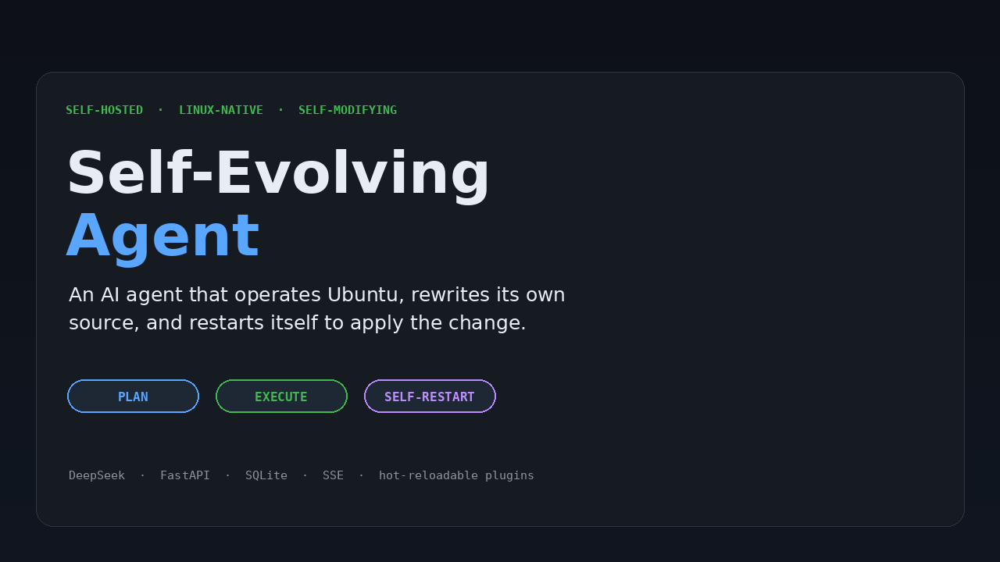
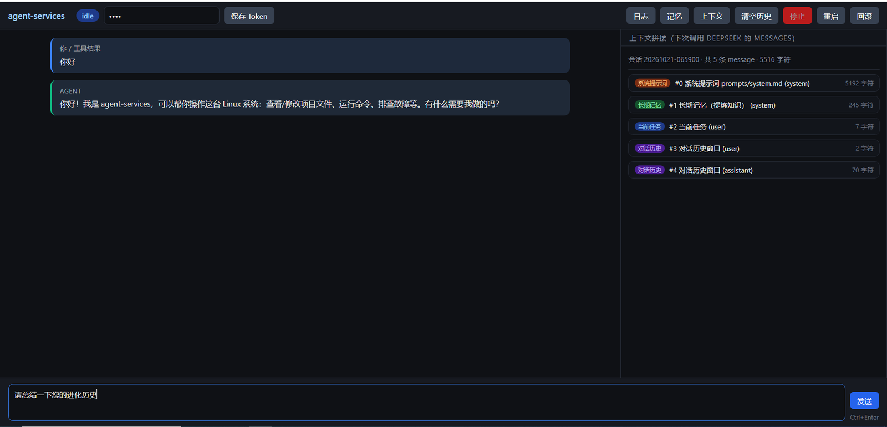
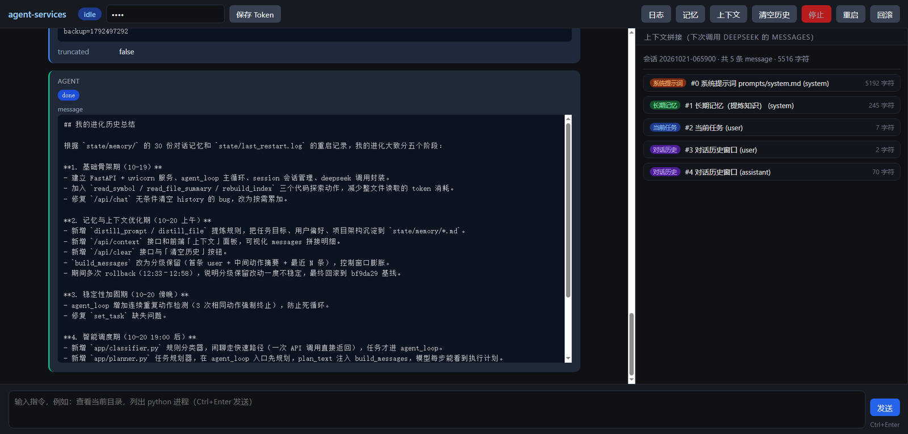

# Self-Evolving Agent

**一个运行在自己的 Ubuntu 上、能操作整台主机、改写自身源码并重启生效的 AI Agent。**

[](https://github.com/xieshengGZ/self-evolving-agent/actions/workflows/ci.yml)
[](docs/VERSIONING.md)
[](LICENSE)
[](https://www.python.org/)

[English](README.md) · [架构](docs/ARCHITECTURE.md) · [路线图](docs/ROADMAP.md) · [v1.2.0 发布说明](docs/releases/v1.2.0.md)



> **v1.2.0 stable，仍属早期基础设施。** 它会执行 shell 命令，也能修改自己的代码。请放在可丢弃的 VM 中运行，不要直接用于生产主机。见[安全说明](#安全)。

## 为什么做这个

大多数 Agent 只是套了工具调用的聊天窗口。这个项目是一个长期运行的 Linux 守护进程：用 DeepSeek 规划，执行真实的 shell/文件操作，验收计划，持久化所有事件，并且能更新自己的源码后重启。工具、规划器、分类器、上下文段和 HTTP op 都是可热加载插件，大多数扩展不需要重启进程。

它刻意保持小而可审计：FastAPI、SQLite、插件注册表和一个 Agent 主循环。没有云控制面，没有向量数据库，也没有隐藏的编排服务。

## 能力

- **操作主机** — shell、读写文件、查看进程和服务、带超时执行命令。
- **先规划再执行** — `planning → executing → verifying → done/replan` 状态机，带确定性验收。
- **重启不丢状态** — 会话、消息、事件、计划、上下文和 artifact 持久化在 SQLite/磁盘。
- **改写自身** — 备份、语法检查、`execv` 重启，失败自动回滚。
- **不重启扩展** — 工具、规划器、分类器、上下文段、HTTP op 均可插件化热加载。
- **全程流式** — Web UI 通过 SSE 接收工具输出和状态变化。
- **控制上下文预算** — 优先级 Section、token 预算、压缩、大结果 artifact 卸载。
- **手动救援** — `/manual` 页面可看日志、执行命令、重启服务。

## 快速开始

环境：Ubuntu 22.04/24.04、Python 3.12+、`systemd`、DeepSeek API Key。

```bash
git clone https://github.com/xieshengGZ/self-evolving-agent.git
cd self-evolving-agent
./install.sh
```

安装脚本会创建 `.venv`、安装依赖、询问一次 API Key、生成随机的 Web token，并安装 systemd 服务。如果直接以 root 运行，脚本会警告并以 root 安装服务；更推荐普通用户 + `sudo`。然后打开：

```text
http://<你的主机>:8088
```

token 保存在 `.env` 的 `AGENT_WEB_TOKEN`，填入 Web UI 的 token 输入框。

<details>
<summary>手动安装</summary>

```bash
python3 -m venv .venv
.venv/bin/pip install -r requirements.txt
cp .env.example .env
# 编辑 .env：填入 DEEPSEEK_API_KEY 和 AGENT_WEB_TOKEN
./deploy.sh
```
</details>

### 配置

| 变量 | 默认值 | 用途 |
|---|---|---|
| `DEEPSEEK_API_KEY` | 必填 | 模型 API Key |
| `DEEPSEEK_BASE_URL` | `https://api.deepseek.com` | OpenAI 兼容端点 |
| `DEEPSEEK_MODEL` | `deepseek-chat` | 模型名 |
| `AGENT_WEB_TOKEN` | 必填 | Web/API Bearer token |
| `AGENT_PORT` | `8088` | HTTP 端口 |
| `AGENT_MAX_STEPS` | `20` | 单任务最大动作数 |
| `AGENT_CONTEXT_BUDGET` | `12000` | 上下文 token 预算 |
| `AGENT_ARTIFACT_OFFLOAD` | `1` | 大工具结果卸载到 `state/artifacts/` |

完整配置见 [`.env.example`](.env.example)。

## 工作方式

```text
Web UI / API
    │ prompt
    ▼
classifier ── chat / control ──► 直接回答或停止/重启
    │ task
    ▼
planning 插件 ──► 带验收条件的计划
    │
    ▼
agent loop ──► DeepSeek ──► 单个 JSON 动作 ──► tools / plugins
    │                                              │
    │◄──────────── 结果 + 事件（SSE）──────────────┘
    ▼
verify ──► done / replan（有上限）
```

| 层 | 位置 | 职责 |
|---|---|---|
| 内核 | `app/kernel/` | 主循环、注册表、插件加载、SSE、预算 |
| 领域 | `app/planning.py`、`app/context.py` | 计划状态机、验收、上下文 Section |
| 存储 | `app/storage.py`、`state/agent.db` | 会话、消息、事件、计划 |
| 插件 | `plugins/*` | 工具、规划器、分类器、上下文段 |
| Web | `app/static/` | 聊天 UI、上下文检查器、手动救援 |

## 截图

| 对话与上下文账本 | 计划执行与流式输出 |
|---|---|
|  |  |

## 安全

这是一个**单用户、可信主机**工具。按设计，它拥有运行服务用户的文件系统和 shell 权限。

- 在可丢弃的 VM 或专用主机上运行。
- 不要在没有反向代理、TLS 和网络控制的情况下直接暴露到公网。
- Web token 是 bearer secret，请使用足够长的随机值。
- shell 命令和计划验收命令权限很高，请审查动作。
- 自更新有备份和回滚，但不是沙箱。
- 文件和命令输出中的 prompt injection 仍是风险。

部署前请读 [SECURITY.md](SECURITY.md)。

## 开发

```bash
python3 -m venv .venv
.venv/bin/pip install -r requirements-dev.txt
make check                 # compileall + 97 tests
.venv/bin/python -m app.cli status
.venv/bin/python -m app.cli map
```

CI 在 Python 3.12 上运行同一套 `make check`。版本规则见 [docs/VERSIONING.md](docs/VERSIONING.md)：MINOR 单数为开发中、偶数为稳定版。

## 路线图

- **v2.1.0** — 类型化特权操作、root helper、审批与审计
- **v2.2.0** — 快照、回滚、沙箱策略
- 上下文质量：内置 LLM 压缩、artifact 保留上限

见 [docs/ROADMAP.md](docs/ROADMAP.md)。

## 贡献

欢迎 issue 和 PR。先读 [CONTRIBUTING.md](CONTRIBUTING.md)；插件只依赖 `app.kernel.api`，改动请带测试。如果这个项目对你有用，点一个 star 能让更多人看到它。

## License

MIT — 见 [LICENSE](LICENSE)。
